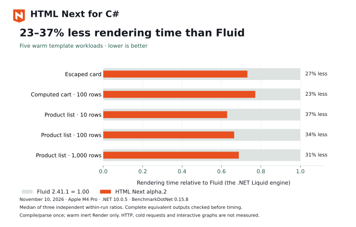

# Render HTML Next with C#

Install the NuGet package, compile a component once, and render it with request data. For an interactive page, build matching JavaScript assets and hydrate the same component in the browser.

Requires .NET 10. Browser builds also require Node 24 and Vite.

## Install and render

Create an ASP.NET application:

```sh
dotnet new web -n HtmlNextDemo --framework net10.0
cd HtmlNextDemo
dotnet add package NextWebWG.HtmlNext --version 1.0.0-alpha.2
```

Replace `Program.cs`:

```csharp title="Program.cs"
using HtmlNext;

var app = WebApplication.CreateBuilder(args).Build();
var card = HtmlNextCompiler.Compile("""
    <template component="x-card">
      <defs><prop name="title" type="string" required>Card title.</prop></defs>
      <article><h1>{$title}</h1></article>
    </template>
    """, "card.html");

app.MapGet("/", (string? title, CancellationToken cancellationToken) =>
    Results.Content(card.Render(new { title = title ?? "Hello from C#" }, cancellationToken),
        "text/html; charset=utf-8"));
app.Run();
```

Run `dotnet run --urls http://localhost:5000` and open `http://localhost:5000/?title=Welcome`. The response contains `<article><h1>Welcome</h1></article>`. Text and attribute bindings escape supplied values.

The application obtains request data. The retained template is immutable and can serve concurrent requests; each render owns its input snapshot. `Render` returns a string, and `Write` writes to a `TextWriter`. Both accept cancellation. Use `Validate` for declared root prop constraints.

## Keep the page interactive

The [full-stack guide](/html-next/full-stack) supplies runnable Node and C# applications using identical component and browser-module files. Both render a count and a computed double on the server. JavaScript then adopts the rendered elements, connects the module and continues updating the declared graph when the user clicks.

The C# setup has three steps:

1. Build the component with `@nextwebwg/html-next-unplugin` and `hydrate: true`. Keep its JavaScript, stylesheets and `html-next.manifest.json` together.
2. Read the manifest with `HtmlNextServerAssets.FromManifest`, then compile the matching source with those assets. Retain that graph or template at application startup.
3. Render with `new HtmlNextRenderOptions { Interactive = true }` and load the built browser entry, which imports `hydrate` from `virtual:html-next/hydrate`.

Source fingerprints are checked during compilation. Rebuild and deploy the source and assets together after a component changes. Include the graph's emitted stylesheets when the component uses styles.

C# supplies initial rendering and the browser handoff. Browser modules own event handling, later state changes, subscriptions and refreshes. The current C# input supports the JavaScript module `connect` pattern used in the example; declarative `<handler>` bodies and `on:` attributes remain outside its supported input.

## Rendering speed

[](/html-next/performance#csharp-rendering)

The comparison uses Fluid 2.41.1, the .NET Liquid implementation, and checks complete equivalent output before timing. See [performance and measurement limits](/html-next/performance#csharp-rendering).

## API and examples

- [NuGet package](https://www.nuget.org/packages/NextWebWG.HtmlNext)
- [Complete C# counter application](https://github.com/nextwebwg/html-next/tree/main/packages/html-next-dotnet/examples/counter)
- [Renderer API and supported input](https://github.com/nextwebwg/html-next/blob/main/packages/html-next-dotnet/README.md): component graphs, source resolution, stylesheets, prop validation and application-prepared module data.
- [Full-stack Node and C#](/html-next/full-stack)
