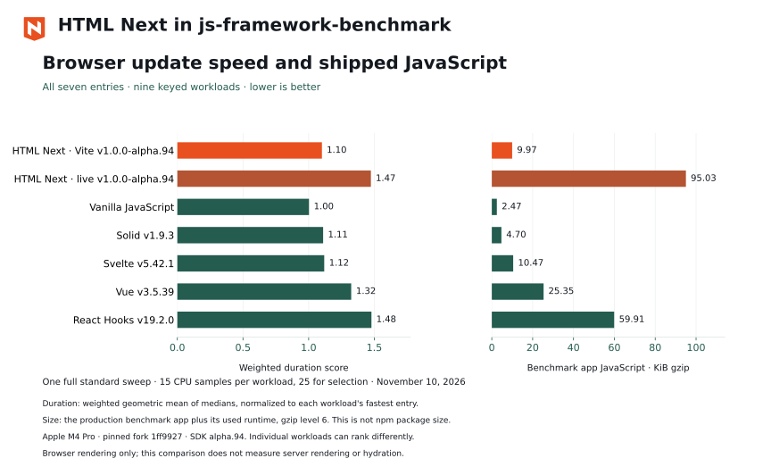
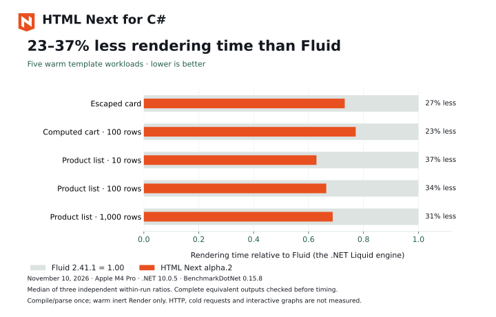

# Measured rendering speed and JavaScript size

Compare HTML Next's browser rendering with other frameworks, and its C# template rendering with Fluid, the .NET Liquid engine. These measurements cover separate execution phases. The [Node and C# examples](/html-next/full-stack) demonstrate the complete server-rendering and browser-hydration workflow.

## Browser rendering and size

The chart uses one full standard sweep of the pinned js-framework-benchmark fork, with all seven entries and nine keyed workloads. Lower values are better in both panels.

| Production benchmark application | Duration score | gzip JavaScript bytes |
| --- | ---: | ---: |
| HTML Next · Vite 1.0.0-alpha.94 | 1.101 | 10,206 |
| HTML Next · live 1.0.0-alpha.94 | 1.474 | 97,314 |
| Vanilla JavaScript | 1.003 | 2,529 |
| Solid 1.9.3 | 1.110 | 4,812 |
| Svelte 5.42.1 | 1.119 | 10,722 |
| Vue 3.5.39 | 1.324 | 25,963 |
| React Hooks 19.2.0 | 1.478 | 61,343 |

The duration score is the weighted geometric mean of median total durations, normalized to the fastest entry in each workload. Workloads are create, replace, update every tenth row, select, swap, remove, create 10,000 rows, append and clear.

HTML Next's compiled Vite build compared with each framework control:

| Control | HTML Next / control | Overall rendering time |
| --- | ---: | ---: |
| Solid | 0.992 | 0.8% less time |
| Svelte | 0.984 | 1.6% less time |
| Vue | 0.832 | 16.8% less time |
| React Hooks | 0.745 | 25.5% less time |

These are aggregate comparisons from this sweep. The 0.8% gap against Solid and 1.6% gap against Svelte are close results; one sweep does not establish a stable advantage at that scale. The results do not establish that one entry is faster in every workload or application. The raw receipt contains every workload's median.

Size is the production benchmark application's JavaScript plus its used runtime, compressed per file at gzip level 6. It is not the npm tarball size. The compiled Vite entry imports the helpers used by its component; the build-free live entry includes its component parser and interpreter. Both are shown separately.

## Reproduce the browser comparison

Measured November 10, 2026 on Apple M4 Pro running macOS 27.2, Chrome for Testing 156.0.8078.4 and Node v24.20.0. The serial sweep used the standard counts: 15 CPU samples per workload and 25 for selection. No local builds or test runners overlapped the timed sweep.

The harness pins [js-framework-benchmark](https://github.com/krausest/js-framework-benchmark) through the [Next Web WG fork at `1ff9927`](https://github.com/nextwebwg/js-framework-benchmark/tree/1ff9927d4cb4dcc2a3e37c1adf8d993f64f4e92a). Control versions and lockfiles are fixed at that pin. The generated HTML Next candidate removes the obsolete `nullable` attribute from the fork's selected-row declaration; its initial null value, controller and workloads are unchanged.

- [Current raw measurement receipt](https://github.com/nextwebwg/html-next/blob/main/packages/html-next/benchmarks/framework-results/20261110T180342Z-366e0fe.json)
- [Harness, scoring and reproduction commands](https://github.com/nextwebwg/html-next/blob/main/packages/html-next/docs/framework-benchmark.md)
- [Chart sources and generation](https://github.com/nextwebwg/html-next/tree/main/assets/performance)

The measured HTML Next Vite artifact has SHA-256 `a5bccfc79cff7a31f67dcb135583a4ca37950b61c1373980b36b99467364e1b7`, built from commit [`366e0fea`](https://github.com/nextwebwg/html-next/commit/366e0fea693dd04d418a429b2ee0f7dbd52c6f73), SDK `1.0.0-alpha.94`. This is one standard sweep on one shared host, not an independent repeated-run optimization comparison. It measures browser rendering, not server rendering, hydration, startup or network delivery.

## C# rendering {#csharp-rendering}

The native `NextWebWG.HtmlNext` `1.0.0-alpha.2` renderer used **23% to 37% less rendering time than Fluid 2.41.1** across five fixed warm-template cases: an escaped card, a computed 100-row cart, and product lists of 10, 100 and 1,000 rows. Each engine's complete output matched an independently constructed expected string before timing. Templates were compiled or parsed once outside timing.

Three independent BenchmarkDotNet ShortRun sweeps per revision ran serially on an Apple M4 Pro with .NET 10.0.5. The single-pass inert-rendering change reduced the median sum of native times from 261.104 to 181.788 microseconds, or 30.4%, compared with the original renderer. It preserved the measured warm per-render allocations. The native renderer allocated fewer bytes than Fluid in all five cases.

These are warmed inert-template results from one host. Selection and reporting use the same cases; no held-out workload was configured. Cold requests, HTTP throughput, complex interactive component graphs and sustained server concurrency were not measured. The browser chart above measures a different phase and cannot be used to compare C# rendering with React or other JavaScript frameworks.

- [Native data, output hashes and samples](https://github.com/nextwebwg/html-next/blob/main/packages/html-next-dotnet/benchmarks/results/2026-11-10-single-pass.json)
- [Native implementation, method, allocation results and limits](https://github.com/nextwebwg/html-next/blob/main/docs/optimize/native-fluid-report.md)
- [Install the NuGet package and render a response](/html-next/dotnet)
- [Run full-stack Node and C# examples](/html-next/full-stack)

## How builds compile components {#compiled-output}

The Vite plugin and `html-next build` compile every component to plain JavaScript that creates and updates native DOM. No template interpreter, type parser or component parser ships to the browser.

- **Templates are cloned.** Each component's static markup is built once into a prototype and cloned for every instance, branch and list row.
- **Updates are direct.** Every binding knows which state it reads, and writes its element only when its converted text or value changes. A change to one state value touches only the bindings that read it.
- **Keyed lists move rows.** `$each` with `$key` keeps each row's element, moves only rows outside the longest stable run, and removes adjacent rows together. Selecting a row by key updates only the old and new rows.
- **Only what you use ships.** A component imports only the helpers its features need. Each prop and event type compiles to its own check, so a component with `keyword` props does not carry list, object or color parsing.
- **Behavior matches the browser runtime.** Compiled components give the same DOM, validity messages, warnings, controller host, lifecycle order and hydration as definitions loaded in the browser. The repository's parity tests hold the two to each other in Chromium, Firefox and WebKit.

The [compiled components reference](https://github.com/nextwebwg/html-next/blob/main/packages/html-next/docs/compiled-direct-path.md) describes the architecture and the size budgets.

