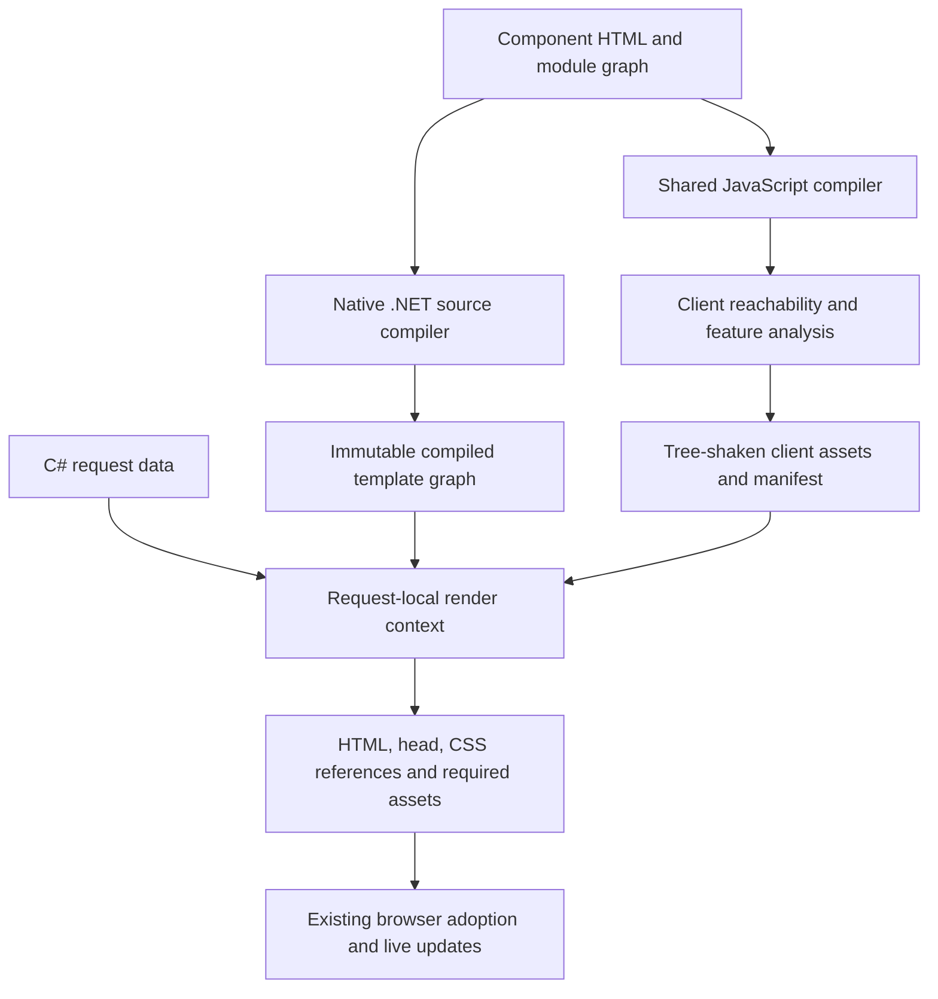
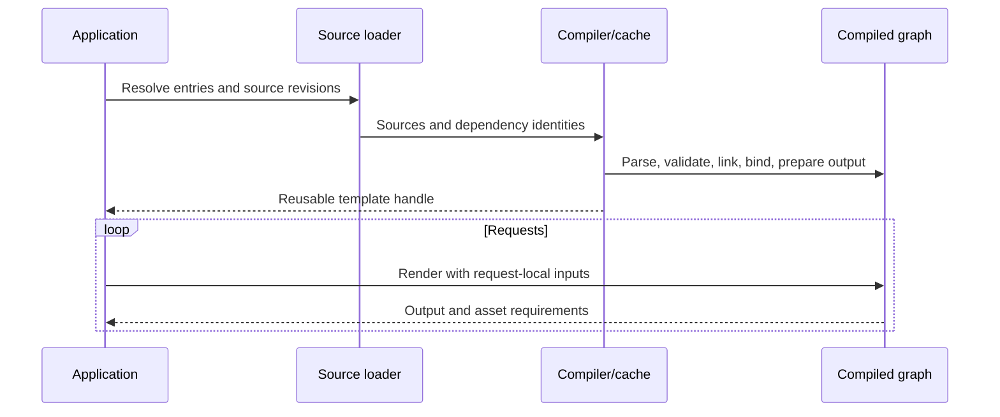

# C# HTML Next Renderer - Plan

Propose a native .NET renderer in `packages/html-next-dotnet`: compile component definitions once into an immutable rendering plan, then reuse that plan with C# application data. Render directly to HTML, and use the existing JavaScript compiler to produce the smallest required browser runtime. Node.js and C# consume the same client-dependency decisions and client assets.

The performance goal is to beat Liquid on equivalent template and data-binding work, with Fluid as the primary .NET Liquid implementation. Compare C# with Node.js separately using the same HTML Next components, data, and output obligations. No performance result has been measured for this proposed package.

This is a tooling implementation proposal. The public [Declarative Components proposal](https://nextwebwg.org/declarative-components/) in `nextwebwg/specs` remains the language authority. API names and package layout below are proposed, and do not establish a new language specification or support profile.

## Goal Capsule

- Objective: .NET applications render the same HTML Next component libraries as JavaScript applications, with fast repeated data binding and only the browser code their interactive behavior requires.
- Means: cached native rendering plans and a shared compiler-owned client plan, described in KTD1 through KTD5.
- Authority: the public proposal governs component behavior; repository guidance governs implementation and delivery; this document proposes the .NET integration.
- Execution profile: staged pull requests, with internal milestones before declaring complete renderer support. This request authorizes design work; implementation and publication are separate actions.
- Stop conditions: preserve the approved compilation model and shared client analysis. Escalate a language ambiguity to the public proposal owner rather than defining new component semantics here.

---

## Product Contract

### Summary

An application loads a component graph at startup or on first use, compiles it once, and retains a reusable template handle. Rendering supplies request data and produces HTML, head contributions, CSS references, and the client assets needed for subsequent interaction. Rendering another request reuses the plan and creates fresh instance state.

### Problem Frame

HTML Next currently provides JavaScript tooling and Node server rendering. A .NET application needs a native way to bind its data to the same component definitions and deliver interactive components without operating a Node rendering service. Familiar template-engine usage and competitive warm-render performance matter alongside HTML Next interoperability.

### Requirements

#### Compilation and .NET integration

- R1. Add the renderer as a separate package under `packages/`, with .NET source, builds, examples, and tests owned by that package.
- R2. Compile and validate a component graph once into an immutable plan that concurrent renders can reuse.
- R3. Accept ordinary C# data through an explicit model adapter, including objects, dictionaries, lists, and the component language's supported scalar values.
- R4. Support files, embedded resources, and application-supplied source text without requiring a Node process in the deployed rendering application.

#### Rendering and browser behavior

- R5. Preserve the public proposal's server-renderable component behavior, including typed inputs, initial state, expressions, nesting, slots, scoped CSS, head contributions, and rendered form.
- R6. Keep request data and instance state separate from cached definitions and from other renders.
- R7. Hydrate through existing HTML Next browser machinery, preserving later updates, controller lifecycle, and DOM identity.
- R8. Derive browser requirements from shared JavaScript compiler analysis used by both Node and C# delivery.
- R9. Include only the client behavior reachable from the chosen application entries and their supported future interactions.

#### Performance and evidence

- R10. Target faster warm rendering and data binding than Liquid on equivalent workloads, using Fluid as the primary .NET comparison.
- R11. Compare C# and Node.js with identical HTML Next template graphs, equivalent input data, and matching rendering obligations.
- R12. Validate full outputs outside timed regions and report cold compilation, warm rendering, binding, allocations, and concurrent serving separately.

### Acceptance Examples

- AE1. Covers R2 and R6. Two concurrent renders of one cached card template, with different users and props, produce independent output without reparsing or sharing accepted input values.
- AE2. Covers R5 and R7. A server-rendered disclosure retains initially hidden slot content; browser hydration adopts its root, and clicking its declarative handler reveals that content.
- AE3. Covers R8 and R9. A page containing server-bound content and one interactive counter delivers the counter's required helpers without pulling in unused request, transition, or data-provider helpers.
- AE4. Covers R9. A branch initially absent on the server but reachable through a later client state change retains the code and styles needed to render it.
- AE5. Covers R10 through R12. A cached product-list template beats cached Fluid rendering on validated equivalent work, while a separate C#/Node comparison includes HTML Next hydration costs on both sides.

### Scope Boundaries

Liquid supplies the template-engine comparison and workflow example. Liquid syntax compatibility, Blazor conversion, and generated C# source are separate proposals. This design compiles source into an internal plan and reuses it.

Client asset generation uses the existing JavaScript build toolchain. The native .NET rendering package remains usable without it for server output. An interactive deployment supplies a matching built asset manifest; the renderer does not start a JavaScript bundler during a request.

Internal milestones may exercise smaller workloads, but they do not establish a public language subset. Complete support requires the full applicable component behavior and the real Looma catalog pressure test.

---

## Planning Contract

### Assumptions and proposal status

Compile once and reuse, the separate monorepo package, the Liquid performance goal, the Node comparison, and shared client-dependency logic are established direction. Native .NET execution, the API shape, dependencies, and release integration below are design proposals. Detailed private source provenance is retained in the workspace context.

Propose `net10.0` for the initial target. .NET 10 is the active LTS; .NET 8 and 9 approach end of support in November 2026, so adding them needs a demonstrated consumer requirement. [Microsoft support policy](https://dotnet.microsoft.com/en-us/platform/support/policy/dotnet-core)

### Key Technical Decisions

- KTD1. Compile once into an immutable plan. Parse HTML, validate declarations, bind expression references, link components, prepare CSS, and combine static output during compilation. Retain per-request evaluation and instance state in a render context. Governs R2 and R6. (session-settled: user-approved; chosen over mandatory generated C# source and repeated parsing, after comparing cached templates with build-time generation.)
- KTD2. Use one compiler-owned client plan. Add client reachability analysis to `@nextwebwg/html-next`, then have bundler adapters and server hosts consume its result. The .NET renderer reads an emitted manifest and does not reimplement JavaScript module analysis or client liveness. Governs R8 and R9. (session-settled: user-directed; chosen over separate C# and Node analyses to keep smallest-runtime selection consistent.)
- KTD3. Render through specialized operations and an HTML writer. Static markup is pre-escaped and combined; expressions use bound references and cached model accessors. Build a temporary fragment tree only where HTML parsing or projection semantics require one. No document-wide browser simulation or reactive scheduler is part of ordinary warm rendering. Governs R5, R10, and R11.
- KTD4. Preserve language semantics across hosts. Port the relevant evaluators and serializers to C# against the public proposal and current implementation evidence. Generate shared static tables from one repository owner where practical; do not serialize the entire TypeScript AST as an assumed stable cross-language API. Governs R3, R5, and R7.
- KTD5. Separate server compilation from client packaging. Source compilation works natively in .NET. Interactive applications build matching client assets once using the existing JavaScript compiler, and supply those assets to the renderer at deployment. Governs R4 and R8.

### Native platform audit

| Concern | Existing mechanism | Remaining implementation work |
| --- | --- | --- |
| HTML parsing | AngleSharp provides an HTML parser and DOM | Check context-sensitive fragments, templates, foreign content, and source locations against browser parsing; map parsed nodes into plans |
| Output | .NET writers, spans, encoders, and buffer writers | Context-sensitive HTML serialization and rendered-form markers |
| Model access | `JsonTypeInfo`, metadata getters, dictionaries, explicit adapters | Bind component names to cached accessors and preserve value distinctions |
| Async lifetime | `ValueTask`, cancellation tokens, async disposal | Apply them to source loading and application preparation |
| CSS | AngleSharp.Css is an available parser candidate | Prove preservation of modern syntax and port component scoping transformations |
| Formatting | .NET globalization facilities | Establish the precise gap against HTML Next's Intl operations, locale behavior, and option validation |
| Browser hydration | Existing generated factories and feature helpers | Share liveness analysis and emit interoperable records and asset references |

AngleSharp is the proposed HTML parser, subject to focused compatibility checks. [AngleSharp](https://github.com/AngleSharp/AngleSharp) and [AngleSharp.Css](https://github.com/AngleSharp/AngleSharp.Css) supply parsing infrastructure, not proof of complete HTML Next semantics. In particular, a CSS parser that discards unknown rules is unsuitable for this compiler.

### Architecture



The source compiler owns parsing and semantic validation. A compiled graph owns component definitions, source identities, expression plans, static segments, stylesheet artifacts, and dependency links. A render context owns accepted inputs, state, loop scopes, slot assignments, provider results, head reconciliation, and hydration records.

The shared client plan describes client requirements, not server evaluation. C# therefore needs a native semantic implementation, but does not need a second browser runtime or module analyzer.

### Proposed API and workflow

These are API design sketches, not implemented methods or copy-ready examples.

| Surface | Inputs | Result and lifetime |
| --- | --- | --- |
| `HtmlNextCompiler.CompileAsync` | Source entries, resolver, compile options, cancellation | Immutable `CompiledComponentGraph`; retain across requests |
| `graph.Template` | Component tag | Reusable `CompiledTemplate` handle; unknown tags fail immediately |
| `template.RenderAsync` | `RenderInputs`, render options, cancellation | Buffered `RenderedComponent`; no partial result on failure |
| `template.WriteAsync` | Same inputs plus a writer | Writes body HTML; returns head, style, asset, and diagnostic metadata |
| `ModelContract` | Declared .NET model types and accessors | Reusable name-to-member mappings; application-owned |
| `ClientAssetManifest` | Existing compiler output and deployed URLs | Matching client plan, bundle entries, CSS artifacts, and compatibility identity |

Conceptual application flow:

```text
startup:
  compile the product component graph
  retain its product-card template
  load the matching client asset manifest if the page will be interactive

request:
  obtain product data using application services
  render the retained template with that product as props
  assemble the returned body, head, styles, and client assets
```

`RenderInputs` contains props, optional declared-state seeds, projected content, and optional application preparation. Prop names are component names; adapters make .NET naming conventions explicit. Omitted props retain the definition's behavior, supplied null follows the existing typed-input boundary, and an explicit missing-value sentinel represents release of caller ownership where needed. Unknown props or state names produce diagnostics.

Projected content uses distinct text and parsed-markup inputs, with named-slot assignment. Text is escaped. Markup is parsed with the correct HTML context and the component language's projection rules. Component values never become raw markup through `ToString()`.

`RenderedComponent` exposes body HTML, head contributions, CSS or stylesheet references, style ownership, required client entries, and diagnostics. The application owns document assembly and CSP nonces. Composition uses one render context so nested components share the correct owner relationships and styles are deduplicated.

Propose two explicit delivery choices on render options: `Inert`, the default, emits server output without a promise of later adoption; `Interactive` requires matching client assets and emits the records its client plan needs. Both use the same component semantics. This is a tooling delivery choice, not a language support profile. The Fluid comparison uses inert output; the full C#/Node comparison uses matching choices on both sides.

Buffered rendering is the simplest default. Writer rendering may leave partial output if cancelled or if a later evaluation fails; callers should buffer before committing an HTTP response when they need atomic output. A synchronous rendering path can complete without async machinery when compilation and application preparation have already finished; async source loading and preparation retain cancellation.

### Compilation, caching, and invalidation



The application retains handles for its deployed graphs. The compiler can coalesce simultaneous compilation of the same graph, but rendering through a retained handle does not perform a source check or hash lookup per request. Source identity includes resolver identity, canonical URL, content revision, transitive dependencies, compiler options, and implementation version.

Application loaders supply explicit revisions or content hashes. Reloading creates a new immutable graph and atomically replaces the application handle; in-flight requests finish on the old graph. Failed replacement leaves the old handle intact and reports the error to the reloader. Source observation and production reload policy remain application responsibilities.

Definition storage never caches request data. A dynamic-source host may bound its compilation cache using normal host cache facilities; no fixed cache capacity or eviction quota is assumed. A cancelled caller awaiting shared compilation does not cancel other callers' work. Failed compilations are removed from the in-flight entry so corrected sources can be retried.

### Binding C# data

Dictionary and JSON inputs use their existing names. POCO contracts use registered metadata or explicit accessor delegates; a convenience reflection adapter builds and caches descriptors once per model type. Property lookup does not use reflection on each loop iteration. Source-generated `JsonTypeInfo` metadata is an available route for trimming-sensitive applications. [System.Text.Json source generation](https://learn.microsoft.com/en-us/dotnet/standard/serialization/system-text-json/source-generation)

The compiler can bind lexical references before a model type is known. Bind member accessors for a particular template/model-contract pair during registration or first use, and cache that specialization separately from request values. Measure this first-use binding cost separately from a warm render. Freeze registered metadata before sharing it among requests.

Each render presents a stable data view: values read by expressions are memoized per request, and collection enumerables are materialized once where repeated traversal is required. Callers retain responsibility for avoiding concurrent mutation of their supplied objects during a render. Getter exceptions become source-associated render errors, and cancellation disposes active enumerators.

The internal value model distinguishes missing, null, invalid, negative zero, scalar, list, and record values. It follows the component language's number operations and equality rules; C# `decimal`, culture-sensitive conversion, and CLR object equality are not substitutes. Numeric inputs outside the supported finite-number domain are diagnosed rather than silently rounded. Dates and instants use explicit adapters to the language's value forms.

Ordinary data binding does not require a JSON serialize/parse round trip. Only values required for hydration are serialized, following the current implementation's tagged value encoding, identity handling, and rejection behavior.

### Fast rendering plan

Compilation lowers each template into literal runs, escaped text writes, attributes, conditions, loops, component calls, slot operations, and hydration record writes. It binds scope references to indices and constant record keys to accessor descriptors. It folds expressions only when their value is independent of render inputs and host environment.

Warm rendering walks those operations with request-local scopes. It avoids rebuilding the definition DOM, allocating a live signal graph, rediscovering module exports, or compiling styles. Static segments already contain correctly escaped markup. Dynamic attributes retain native boolean, namespace, URL, and form-control serialization rules.

Specialized delegates can implement operations without emitting runtime IL. Runtime code generation, a Roslyn source generator, and a second interpreter for AOT are not prerequisites of this architecture. Measure the bound operation executor before considering additional compilation tiers.

Dynamic `$html` and caller-supplied markup still require fragment parsing and sanitization. Charge those operations to the features that request them, cache only immutable validated source artifacts, and preserve the same safe output as the JavaScript path.

### Shared selection of the smallest client runtime

The shared compiler analysis starts from application entries and explicit browser roots, including components exposed for programmatic creation or update. It follows template invocations, slots, provider/context relationships, browser module exports, declarative handlers, data dependencies, and the values they can change. It then computes the live dependency closure and the helper imports needed to adopt and update that closure.

| Graph content | Required browser contribution |
| --- | --- |
| Static markup and server-only data binding | HTML and CSS; no hydration runtime solely for those values |
| Declarative handler changing state | Handler, state, and affected rendering helpers |
| Two-way control binding | Control event handling, conversion, and reachable updates |
| Browser module with `connect` | Lifecycle and host features needed by that module boundary |
| Client read or prepared data requiring later refresh | Adoption/data helpers plus downstream updates |
| A reachable keyed list or structural branch | Its list/branch helpers and reachable descendants |
| Dynamic component creation/update exposed by the application | All declared possible components and update capabilities |

A declared prop, interpolation, or state value is not sufficient by itself to prove client liveness. Conversely, absence of `connect` is not proof that a component is static. Opaque browser modules conservatively retain everything reachable through their supported host interface; the compiler does not infer purity from arbitrary JavaScript bodies.

Unknown programmatic component creation, updates, or host access retain all possible public entries and their observable state. Prune a component only when the application's closed graph proves those operations cannot reach it. A small bundle must not change the behavior of an existing registry or host API consumer.

This analysis is separate from ESM tree shaking. Analysis chooses the adoption entry points and feature roots; the existing generators emit feature-specific imports, and the bundler removes unreachable code. The manifest records graph identity, entry URLs, CSS, per-component adoption needs, required helpers, and diagnostic reasons for retained features.

Preserve dependencies for branches that can become live after hydration. Follow context and slot dependencies across static and active components; a static ancestor must not sever a live descendant's ownership or projected content. Hydrate the smallest provably correct region, retaining structural scaffolding where ownership demands it. Tests, rather than a `connect` flag, establish when a server-only subtree needs no browser record.

Client liveness is determined for the graph's supported future behavior, not merely the branch rendered for one request. Request output may select existing asset entry points, but never starts a new bundler or drops future-reachable branches based on current values.

The .NET compiler matches its graph and options to the client manifest. Server rendering without a manifest is supported as inert output; requesting interactive output without matching assets fails before buffered output is returned. Updating source invalidates both its server plan and matching client artifacts. Existing universal live-loader delivery remains available as its own explicitly selected delivery mode; it is not an automatic substitute for a missing minimal client bundle.

The manifest carries source fingerprints for component definitions and stylesheet dependencies, plus a build identity covering the browser module graph and compiler options. .NET verifies the source fingerprints and declared module identities it consumes, and uses the supplied deployment's browser build identity. It does not reconstruct JavaScript imports to calculate that build identity. Externally sourced definitions therefore need matching built assets before interactive rendering can be requested.

### Server preparation, lifecycle, and hydration

Application services prepare data before rendering, or through an explicit request-scoped preparation adapter with typed inputs and cancellation. C# does not execute a component's JavaScript controller or browser `connect`. Initial declarations and server preparation settle before final head and instance records are written.

Prepared data requires the same source/revision and input-revision identities the browser binding adapter adopts. Values alone do not prove a read completed. Add a C# writer for the existing preparation snapshot format only after verifying the consuming JavaScript path; missing matching snapshots must preserve its normal first-read behavior.

The .NET serializer implements the existing rendered-form and hydration records as a tooling interoperability boundary. Preserve explicit props, accepted values, initial state, shared-root component identity, slot ranges, unrendered projection carriers, form defaults, and relevant owner relationships. Reuse the existing browser implementation, including its processing-instruction/comment compatibility behavior. Do not invent a second hydration format.

The public rendered-form proposal leaves some ownership and wire-format questions open. Existing implementation behavior supplies regression evidence, not authority to close those questions. A mismatch involving portals or an unresolved language rule must be reported against the owner before claiming equivalent support.

### Formatting, styles, and validity

Formatting is a feasibility gate. A common locale name does not make .NET formatting equivalent to ECMA-402 Intl. Differential checks cover options, rounding, number parts/ranges, lists, duration, civil date/time, instants, and invalid results. Determine the exact compatibility adapter needed before the general evaluator is declared complete. Hydration must preserve the JavaScript target's formatting behavior and documented locale/time-zone expectations.

CSS compilation resolves imports and preserves order, conditions, namespaces, scoped roots, projected-content ownership, and state selectors. Prefer the existing compiler's CSS artifacts when matching built assets are supplied. Native compilation of standalone source still needs a validated CSS parser and equivalent transformations; a build artifact requirement cannot silently replace R4.

Validity and input serialization require focused browser comparisons for native controls and ordinary-element constraints. Use the existing generated DOM-property and sanitizer data as shared table owners where applicable. A server DOM library's presence alone does not establish native form semantics.

### Package and release layout

```text
packages/html-next-dotnet/
  README.md
  HtmlNext.slnx
  src/HtmlNext/HtmlNext.csproj
  src/HtmlNext/Compilation/
  src/HtmlNext/Rendering/
  src/HtmlNext/Binding/
  src/HtmlNext/Interop/
  tests/HtmlNext.Tests/
  tests/browser/
  benchmarks/
  examples/MinimalApi/
```

Start with one .NET library; ASP.NET examples use normal application services and response assembly. Add a separate ASP.NET integration assembly only if consumer use establishes a worthwhile API boundary. `HtmlNext` is a proposed package identity, subject to namespace availability.

Keep the four current npm packages on their existing shared release contract. Propose using that same release version for .NET to identify tested companions, with NuGet publication handled explicitly rather than assuming the npm release script publishes a fifth package. Record the tested browser-runtime version and graph/plan format identities in package artifacts.

Initial .NET builds remain non-publishing with MIT metadata. Public visibility, protected NuGet publishing, and any expansion of automatic release behavior follow the repository owner's existing release requirements. Add .NET-aware change selection and checks without putting a .csproj into JavaScript package-manifest enumeration.

---

## Performance Design

### Comparisons and success criteria

The stated goal is to beat Liquid and remain competitive with Node.js HTML Next. Fluid is the primary .NET Liquid baseline; optionally record DotLiquid for additional context, without choosing it solely because it is slower. Pin actual released versions and runtime configurations when constructing the harness.

For the Fluid comparison, implement equivalent templates with identical escaping, data, layout composition, and output. Cache parsed templates and HTML Next plans on both sides. Exclude browser hydration work from this equivalent-work timing, and report its incremental cost on the interactive HTML Next path. Do not make zero-client-code claims for components whose behavior requires hydration.

For Node, use the same HTML Next sources, input values, locale/time zone, and required rendered form. The current public Node renderer is the end-to-end baseline. Record its worker and DOM costs separately; do not present those costs as JavaScript property-access cost. If a direct Node template execution path is added, report it as an additional named baseline and include its implementation revision.

Proposed performance acceptance: warm C# rendering is faster than Fluid across the representative equivalent-work workloads, with the distribution and any losing case reported. C#/Node ratios are reported for each workload; no numerical Node performance threshold has been approved. A broad speed claim waits for repeated measurements that establish the direction beyond measurement noise.

### Workload matrix

| Workload | Input shape and purpose |
| --- | --- |
| Small card | Scalar values, escaping, and conditional attributes |
| Product list | Nested records and lists at multiple sizes; binding and loop cost |
| Composed page | Shared partial/component structure, named slots, and repeated components |
| Expression-heavy page | Computed values, branches, numeric edge cases, and formatting |
| Full interactive page | Same HTML Next output and hydration obligations in C# and Node |
| Real Looma examples | Representative composed catalog pages plus whole-catalog correctness |

Data-binding microbenchmarks isolate dictionary access, registered POCO accessors, JSON inputs, nested paths, and collection traversal. They explain an end-to-end result and never replace template benchmarks.

Measure source loading, parsing/validation, and plan construction as distinct cold stages. Warm timing starts with an existing handle and input model. Report a binding-inclusive render and, separately, preadapted inputs so a costly adapter cannot disappear from the headline number.

Use string-returning output for both sides in one comparison, and writers for both in another. Do not compare allocating a complete output string with discarding bytes to a counting sink. Match emitted bytes where the template comparison permits it; for HTML Next interoperability, compare parsed output and complete hydration records without normalizing away semantics.

### Harness and retained evidence

Use BenchmarkDotNet for .NET timing/allocation detail and a persistent Node harness for corresponding JavaScript work. A shared runner records runtime versions, template/data/output hashes, host CPU, process/core budgets, GC settings, warmup, samples, and both framework revisions. Node processes and render workers stay alive across warm samples.

Measure concurrency under equal CPU budgets. Include single-render latency and sustained throughput/latency distributions, recording queue time separately from engine time. Measure HTTP serving as a separate workload with identical document assembly and transport settings. Server asset files are already built on both sides.

Validate full output, hydration records, and result counts before timing. Preserve small machine-readable summaries and hashes; compact completed raw captures after verifying their receipts. Absolute latency and allocations are reported alongside ratios. No arbitrary memory quota or latency budget is attributed to the owner.

---

## Implementation Units

### PR 1: Establish the native package and prove the rendering approach

Waits on: no earlier PR. Internal experimental builds remain non-publishing.

### U1. Package, binding seam, and measured rendering slice

Goal: prove that a cached native plan can render representative data quickly without choosing a more complex compilation tier prematurely. Covers R1 through R4 and R10 through R12. Dependencies: none.

Files: `packages/html-next-dotnet/src/HtmlNext/HtmlNext.csproj`, `packages/html-next-dotnet/src/HtmlNext/Compilation/`, `packages/html-next-dotnet/src/HtmlNext/Binding/`, `packages/html-next-dotnet/tests/HtmlNext.Tests/CompilationTests.cs`, `packages/html-next-dotnet/tests/HtmlNext.Tests/BindingTests.cs`, `packages/html-next-dotnet/benchmarks/`, and `scripts/ci-plan.ts`.

Approach: implement the KTD1/KTD3 plan for a small measured slice and establish the matched Fluid/Node harness. Probe HTML fragments, CSS preservation, and Intl compatibility early; record remaining gaps before committing public APIs to their adapters.

Test scenarios:

1. Compile a card once, render changing POCO and dictionary inputs, and verify output without reparsing.
2. Render one handle concurrently with distinct props and verify isolation, escaping, and cancellation.
3. Repeat identical outputs through string and writer APIs, and validate the benchmark's full output outside timing.
4. Probe malformed tables, foreign content, modern scoped CSS, and formatting options against current owners; retain concrete gap cases.

Verification: native build/test works from a clean checkout; measured slice results identify warm execution and binding costs. This seam proves the approach, not complete component support.

### PR 2: Share client liveness and delivery metadata

Waits on: PR 1 for merge order; analysis work can start independently from its native builds.

### U2. Compiler-owned client plan and Node consumption

Goal: establish one owner for R8/R9 before adding a C# consumer. Dependencies: none on the .NET rendering slice.

Files: proposed `packages/html-next/src/client-plan.ts` and `packages/html-next/tests/client-plan.test.ts`; existing `packages/html-next/src/generate.ts`, `packages/html-next/src/targets/vanilla-blocks.ts`, `packages/html-next-unplugin/src/index.ts`, `packages/html-next-unplugin/tests/unplugin.test.ts`, [MarkupKit client delivery](https://github.com/threadlabs-studio/markupkit/blob/main/src/browser.ts), and owner-local browser tests.

Approach: implement KTD2/KTD5, feeding analysis into existing generated feature imports and adoption entry points. Reuse current compiled hydration and provider protocols. Keep application navigation and explicit creation/update roots represented in reachability so static pruning does not break MarkupKit navigation.

Test scenarios:

1. A server-only interpolation graph emits CSS/HTML with no hydration entry solely for its values.
2. Adding a handler retains only the required state and affected DOM helpers; adding a module retains its supported host boundary.
3. A future-reachable branch, nested active child, slotted live content, or context consumer survives pruning and updates after hydration.
4. Browser bundles exclude unused features and the universal live parser; Node delivery consumes the same manifest decisions.
5. An unknown registry update or host lookup keeps the observable component behavior intact rather than treating it as server-only.

Verification: retained-feature reasons and actual bundle imports agree; existing generated/runtime and MarkupKit browser regressions pass. This seam proves generated client reachability, not native .NET rendering.

### PR 3: Complete native evaluation and rendered-form interoperability

Waits on: PR 1 before starting; PR 2 before merging interactive asset integration.

### U3. Native component evaluation, composition, and preparation

Goal: implement R3 through R6 against the existing language owners. Dependencies: U1.

Files: `packages/html-next-dotnet/src/HtmlNext/Compilation/`, `packages/html-next-dotnet/src/HtmlNext/Rendering/`, `packages/html-next-dotnet/tests/HtmlNext.Tests/ExpressionTests.cs`, `packages/html-next-dotnet/tests/HtmlNext.Tests/CompositionTests.cs`, and `packages/html-next-dotnet/tests/HtmlNext.Tests/PlatformParityTests.cs`.

Approach: complete KTD3/KTD4 using parser, expression, decimal, type-system, style, sanitizer, and head owners listed in Sources. Resolve U1 feasibility findings before claiming equivalent behavior.

Test scenarios:

1. Compare numeric boundary values, missing/null/invalid values, conditional attributes, and formatting with the JavaScript owner.
2. Exercise nested components, shared roots, slot fallback, scoped content, accepted children, context, and hidden projected content.
3. Verify CSS imports/scoping, dynamic safe HTML, head ordering, and form values against parsed browser output.
4. Cancel preparation and rendering, dispose resources, and confirm later renders on the same plan remain independent.

Verification: differential implementation tests cover complete applicable server behavior. Tests remain tooling regressions, with no local specification or new language profile.

### U4. .NET client-manifest integration and browser adoption

Goal: deliver R7 through R9 through existing browser machinery. Dependencies: U2 and U3.

Files: `packages/html-next-dotnet/src/HtmlNext/Interop/`, `packages/html-next-dotnet/tests/HtmlNext.Tests/HydrationRecordTests.cs`, and `packages/html-next-dotnet/tests/browser/hydration.test.ts`.

Approach: emit KTD4 records and consume KTD2 assets. Adapt the existing Node-to-browser fixture approach rather than building a second hydration runtime.

Test scenarios:

1. Adopt C# output in Chromium, Firefox, and WebKit while retaining root identity and edits made before hydration.
2. Recover explicit props, state, hidden slots, shared roots, form defaults, and prepared reads; perform subsequent updates.
3. Reject mismatched interactive source/assets before returning buffered output; inert rendering remains available.
4. Render one graph from Node and C#, verify the same required asset entries, and run equivalent post-hydration interactions.

Verification: behavior and parsed output match fresh browser rendering across engines. This seam proves adoption and later interaction, beyond matching serializer strings.

### PR 4: Catalog, performance, and consumer delivery

Waits on: PR 3 before starting full catalog and complete-renderer measurements.

### U5. Looma gate, performance receipts, and .NET consumer example

Goal: establish complete support and speed evidence for R5 and R10 through R12. Dependencies: U3 and U4.

Files: `packages/html-next-dotnet/tests/browser/looma.test.ts`, `packages/html-next-dotnet/benchmarks/`, `packages/html-next-dotnet/examples/MinimalApi/`, `packages/html-next-dotnet/README.md`, root verification/change-selection scripts, and appropriate release documentation.

Approach: run the complete real Looma catalog through the native renderer with the shared compiled client assets. Apply Looma's renderer-independent assertions. Publish benchmark reports in repository documentation only after full validation; keep native package publication disabled until its release policy is selected.

Test scenarios:

1. Every catalog component renders, its client output compiles, and the shared rendering/behavior assertions pass without consumer workarounds.
2. Equivalent Fluid workloads and full HTML Next Node workloads pass output checks before repeated timed runs.
3. A clean .NET consumer loads retained templates and serves independent requests with matching deployed browser assets.
4. CI selects native changes and affected shared compiler consumers correctly, with no check exceeding the repository's 15-minute limit.

Verification: report every benchmark case, runtime revision, allocation result, and failing gate. Speed failures lead to measured optimization or an explicit unmet goal, not a changed comparator.

---

## Verification Contract

Implementation uses focused native tests and the repository's `pnpm verify:inner` development gate, followed by `pnpm verify:pr` before handoff. Add explicit .NET build/test and differential commands to root verification rather than assuming pnpm recursively discovers .csproj projects.

The browser gate covers Chromium, Firefox, and WebKit, the complete real Looma catalog, compiled client output, and hydration from both servers. Use one foreground Playwright runner per repository and one worker locally. Preserve independent renderer assertions and fix defects in the owning package.

Benchmarks are separate from routine correctness CI when their duration or host sensitivity requires it. Required correctness checks stay under 15 minutes by sharding. A benchmark report includes skipped cases and environmental limitations.

This design-only change does not run implementation tests or claim native performance. Future implementation gates above are required before capability or speed claims.

---

## Definition of Done

The package can compile a complete supported graph once, render independent requests with native C# data, and hydrate through matching existing browser assets. Node and C# use one client plan, with measured bundle evidence that unrelated runtime features are absent.

The real Looma catalog and cross-browser interaction gate pass. The Fluid speed goal has validated comparative evidence, and C#/Node results distinguish compilation, binding, engine execution, worker/hosting overhead, and full serving cost. Remaining losing cases are visible.

Public API documentation describes actual behavior, compatibility identities, source/cache lifetimes, cancellation, and deployment. Package/release metadata follow repository policy. Remove abandoned experiments and trial build artifacts after preserving compact evidence.

### Deferred Decisions

- Final NuGet identity, version-policy adoption, and public publication workflow are release decisions; they do not block internal native development.
- Exact CSS dependency and formatting adapter follow U1 compatibility evidence; they block complete language support until resolved.
- Optional build-time generation or persisted plans require measurements showing a benefit beyond the retained runtime plan.

---

## Sources and Existing Behavior

SDK source baseline: `cdaaa1ec`, 2026-11-05. Application ownership: Threadlabs MarkupKit `dcc6d63`; the SDK release contains three JavaScript packages. Greptile had no reachable knowledge base for this repository; local source supplied implementation evidence.

| Owner | Relevant evidence |
| --- | --- |
| Public proposal | `nextwebwg/specs`, `html-next/components.md`, `expressions.md`, `javascript.md`, `rendered-form.md`, and `styling.md`; [source repository](https://github.com/nextwebwg/specs/tree/main/html-next) |
| Node rendering | `packages/html-next/src/server.ts` and `server-worker.ts`: isolated worker/JSDOM rendering, preparation, head, CSS, serialized output |
| Normalized definitions | `packages/html-next/src/ast.ts`, `template.ts`, `parser.ts`, and `graph.ts` |
| Expression/value semantics | `packages/html-next/src/expression.ts`, `expression-values.ts`, `decimal.ts`, `type-system.ts`, and `format.ts` |
| Rendered form | `packages/html-next/src/rendered-form.ts`, `hydration-value.ts`, and `runtime.ts` |
| Styles and safe HTML | `packages/html-next/src/component-styles-build.ts`, `stylesheet-resources.ts`, `sanitize-server.ts`, and `sanitizer-default.ts` |
| Existing feature imports | `packages/html-next/src/targets/vanilla-blocks.ts`: emitted-helper selection; `packages/html-next-unplugin/src/index.ts`: support routing and graph build |
| Node-hosted client delivery | [MarkupKit `src/browser.ts`](https://github.com/threadlabs-studio/markupkit/blob/main/src/browser.ts): application-owned browser factories and feature imports |
| Existing regression patterns | `packages/html-next/tests/server-hydration.test.ts`, `hydration-fixtures.ts`, `hydration-value.test.ts`, `format.test.ts`, and `packages/html-next-unplugin/tests/unplugin.test.ts` |
| CI selection | `scripts/ci-plan.ts`: enumerates the three JavaScript SDK package manifests explicitly |
| Liquid baseline | [Fluid](https://github.com/sebastienros/fluid): cached reusable parsed templates; use the released version selected for the actual benchmark |

Current generated clients already select feature helpers, and their tests assert exclusion of the general runtime and parser. That does not establish that all server-only bindings or whole static SSR components are currently omitted: The independent MarkupKit host must consume the shared plan when registering page component factories. U2 adds and verifies the shared client-liveness layer rather than claiming it already exists.
