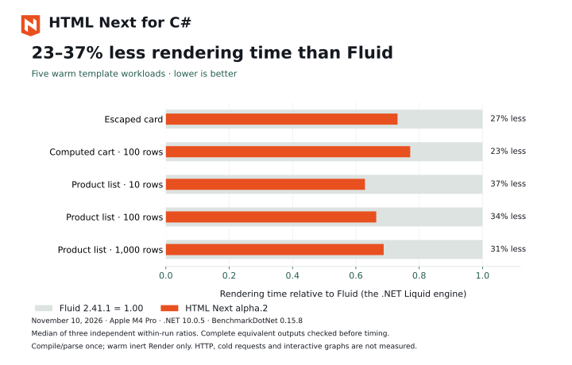

[](https://nextwebwg.org/html-next/)

# HTML Next for .NET

**Universal components. Built with HTML.**

[Documentation](https://nextwebwg.org/html-next/) · [Source and issues](https://github.com/nextwebwg/html-next)

[](https://www.nuget.org/packages/NextWebWG.HtmlNext)
[](https://github.com/nextwebwg/html-next/blob/main/LICENSE)

Compile a component once, keep the returned .NET template, and render it repeatedly with request data. Render inert HTML, or supply matching built assets and select interactive output for adoption by generated browser factories.

The .NET renderer evaluates component templates and binds application-supplied data to initial HTML, as a replacement for Liquid templates. Interactive output includes the records and matching assets consumed by the JavaScript module package during hydration. Applications prepare request data; browser modules own subsequent bindings, interactions and source updates.

The component language is defined by the [public proposal](https://nextwebwg.org/declarative-components/).

## Full-stack C# and JavaScript

Use C# to render request data into initial HTML. Matching generated JavaScript hydrates that markup and continues its state, computed values and browser interactions. The [full-stack guide](https://nextwebwg.org/html-next/full-stack) provides Node and ASP.NET applications using identical component and browser-module files.

For a runnable C# example, copy the [counter application](https://github.com/nextwebwg/html-next/tree/main/packages/html-next-dotnet/examples/counter), then run `dotnet restore`, `npm install`, `npm run build` and `dotnet run --urls http://localhost:5000`. Open `http://localhost:5000/?start=12`: C# renders the count and its computed double; clicking the hydrated button updates both. Requires .NET 10 and Node 24.

The [C# installation guide](https://nextwebwg.org/html-next/dotnet) starts with a minimal ASP.NET response. Applications own request data; browser modules own ongoing interaction. The current C# example uses the supported JavaScript module `connect` hook; declarative `<handler>` bodies and `on:` attributes are outside the C# compiler's current supported input.

## Rendering performance

[](https://nextwebwg.org/html-next/performance#csharp-rendering)

Measured against Fluid 2.41.1, the .NET Liquid implementation, with complete equivalent output checked before timing. Three independent runs per revision on one Apple M4 Pro, using .NET 10.0.5. These are warm template-rendering results; see the [data and limitations](https://github.com/nextwebwg/html-next/blob/main/docs/optimize/native-fluid-report.md).

## Use a retained template

Requires .NET 10. Install the prerelease:

```sh
dotnet add package NextWebWG.HtmlNext --version 1.0.0-alpha.2
```

```csharp
using HtmlNext;

// Create once during application startup.
var card = HtmlNextCompiler.Compile("""
    <template component="x-card">
      <defs><prop name="title" type="string" required>Card title.</prop></defs>
      <article><h2>{$title}</h2></article>
    </template>
    """, "card.html");

// Reuse for each request. Values are read from exact property names.
var html = card.Render(new { title = "Quarterly report" });
```

The compiler accepts source text, so applications can load files or embedded resources before compiling. A template is immutable and safe to share across concurrent renders. Input values, normalized collections, loop bindings, and output buffers belong to one render. The application must avoid mutating supplied objects during that render.

A component's optional `<defs>` region can appear before or after its markup root.

`Render` returns a complete string. `Write` accepts a `TextWriter`. Both accept cancellation; a writer can contain partial output when a later write or cancellation fails. The library leaves the caller's writer open.

Null and omitted inputs use their declared defaults, or read null when no default exists. A non-null default keeps the accepted value non-null; without a default, the implicit default is null. `required` reports validity and does not supply a default. Empty strings, zero, and false remain present. A missing required input or a value of the wrong type reports through the optional `onDiagnostic` callback and rendering continues with the default or null. Both output APIs report each binding failure once. Compilation errors, cancellation, application getter failures, and output writer failures remain exceptions.

`Render` binds and validates inputs once. Simple inert templates make one output pass into a small stack buffer, renting larger arrays when needed before creating the result string. Rented arrays are cleared and returned on success or failure; the shared pool may retain their capacity for reuse. Component graphs, interactive output and module preparation use a counting pass followed by an exact-size string write, reusing their input snapshots. Neither path calls application getters or enumerates application data again. Numeric output uses stack-based formatting. `Write` makes one output pass to the supplied writer. Diagnostic paths are prepared during compilation rather than constructed for every row.

The [native rendering performance report](https://github.com/nextwebwg/html-next/blob/main/docs/optimize/native-fluid-report.md) records repeated comparisons with Fluid, including workload, allocation and measurement limits.

Applications writing directly to a response can use `Write` to avoid allocating the complete HTML string.

## Load a component graph

`CompileResource` compiles every carrier in supplied source text. Use `CompileAsync` when resources declare `<link rel="component">` dependencies. The application resolves each authored reference relative to its importer and returns a canonical identity, source text, and optional revision. A resolver can read files, embedded resources, or application-managed package sources.

For files:

```csharp
static async ValueTask<HtmlNextSource> ResolveFile(
    string specifier, string? referrer, CancellationToken cancellationToken)
{
    var path = Path.GetFullPath(referrer is null ? specifier
        : Path.Combine(Path.GetDirectoryName(referrer)!, specifier));
    return new(path, await File.ReadAllTextAsync(path, cancellationToken));
}

var graph = await HtmlNextCompiler.CompileAsync(["/app/components/page.html"], ResolveFile);
var page = graph.Template("x-page");
var html = page.Render(new { title = "Quarterly report" });
```

Compilation deduplicates canonical resources, handles cyclic dependency links, rejects duplicate component tags, and checks component calls even in initially hidden branches. Each source's identity, revision, UTF-8 SHA-256, and resolved dependency identities are available through `graph.Sources`. Conflicting content or revisions under one canonical identity fail compilation. Retain the graph or its templates; rendering uses the compiled plans without consulting the resolver. Failed or cancelled compilations leave no shared failed-cache entry.

Use `graph.CompileApplication(source, sourceName)` to compile one server-owned application carrier against the retained library. Declare its inputs and composition in that carrier, then retain the returned template for request rendering. Referenced components reuse their typed prop and slot contracts, compiled plans, matching stylesheets, preparation revisions and client selection. Independent application compilations keep separate compiler metadata. The application carrier's own bindings render on the server; build it with the unplugin when it also needs a generated browser factory or stylesheet.

Basic component calls lower to the callee's native output. Written props convert during compilation; `from:` props bind from the caller's scope. Child props keep their own defaults and types, including structured field layouts. Buffered rendering retains each child input snapshot between its counting and writing passes, so binding diagnostics occur once. Writer rendering makes one pass. Child snapshots and scopes belong to the request, including recursive and repeated instances. Deep expansion reports an execution-stack resource exception before exhausting the host's CLR stack.

Named and inline `<type from="selector">` declarations select a prop's type from a finite prop or state value. Ordinary props bind before dependent props, and state selectors initialize before their dependent values bind. Written dependent inputs convert through the selected type during binding. A null selector accepts only a null dependent value. A dependent default requires a prop selector with a default and must satisfy that option's type. Structured values retain their selected field and element types.

A component's expressions check its dependent props against the active option, including defaults. Structured fields are checked when read, so valid sibling fields remain available. Adoption records and CSS prop selectors retain the raw prop values. A structured literal `null` restores the prop's default without a type diagnostic.

Prop and field declarations may carry inert authoring annotations, such as `data-note` and `default-true-reason`; native compilation ignores them.

Resource-level and direct carrier metadata (`title`, `meta` without `http-equiv`, and ordinary metadata links) is ignored by component rendering. Only resource-level component dependency links reach the resolver. Active resource content, policy metadata, HTML Imports, and executable metadata attributes fail compilation.

Projection plans retain the consumer's lexical bindings. Default and named outlets choose assigned nodes or fallback; an empty text node counts as assigned. Conditional and repeated consumer content participates in that selection, and `<template $slot>` uses the same outlet plan. Consumer `<template slot>` bodies render on demand and remain as inert source in serialized carriers. Unused plain content also remains in a carrier, with component setup deferred until placement. Delegated roots write their carriers in outer-to-inner order. These operations stream into the same counting and writing passes without building a per-request DOM.

An unplaced component's placeholder retains its caller's bound props and rendered children. Caller-owned text, attributes, conditions, loops, fragments and forwarding outlets run inside the carrier; the callee's state initialization and required-input diagnostics wait for placement unless an explicit `as` list needs its resolved props. Module specifiers remain build metadata. Invalid or waiting prop bindings retain written literal attributes. Available null and missing field values remove them. Original lazy slot templates retain their source, including their directives.

Scoped outlets compile their declared props into the same immutable plans. Written values and constant bindings convert once during compilation; dynamic inputs bind once per placement and buffered rendering reuses that snapshot. A supplied null, missing value or rejected type takes the declared default, or null. An invalid numeric expression starts at that default/null. An omitted optional prop without a default leaves the consumer's outer binding visible. Consumer template guards read their original scope; projected bodies read the outlet's supplied props. Fallback content reads the receiving component's scope. Scoped props require consumer `<template slot>` content. Repeated outlets and concurrent requests keep separate values, and type-rejection diagnostics are deduplicated per authored outlet and prop within a render.


Slot declarations can restrict projected content with `accepts="x-column"` or a space-separated list of component tags. Matching follows delegated component lineage. Rejected elements and non-whitespace text are omitted and report `HNCS007` once per authored receiving slot and rejected tag within a render. Whitespace is preserved, and empty text remains assigned content. Filtering alone keeps ordinary projection and deferred setup.

An explicit `as` declaration collects accepted-child props before initializing the receiver's state. Default and named lists include children selected through conditions, aliases, matches and iterations. Each preset resolves the accepted base component's props. Preset prop expressions can read their state or computed declarations; unrelated expression state seeds wait for placement. Placing a collected child reuses its prop snapshot, so binding diagnostics occur once. Collection storage belongs to the request and is created only for an `as` list.

References through accepted entries use each child's active selected prop types, including aliases and lists that accept multiple component types. Copying an entry into state creates an ordinary data snapshot; an untyped copy constrains none of its fields.

`<slot of>` places an entry's content in its caller's scope, preserving captured row and index aliases. Indexed entries, computed and structural aliases, and conditional selection across own lists retain their ownership. Null and missing entries render the fallback. Copied records and entries from another component are rejected. Ordinary child outlets and borrowed outlets share plain-content claims, while consumer templates render afresh at each outlet. Borrowed preset content retains its authored scope, including invocation attributes forwarded explicitly through `$attributes`. Repeated ordinary outlets follow the same plain-content and template behavior. Borrowed outlets emit the existing SDK entry-position markers. The client-integration tests cover adoption, reopening and reordering of plain borrowed controls while preserving early edits. See the [proposal's accepted-child contract](https://nextwebwg.org/declarative-components/components#slot-accepts-as).

Compilation validates each component's `$ref` names, including hidden and unused content. Authored duplicate names fail compilation; alternative native roots in a root `$match` may reuse a name. Rendered nodes omit the consumed directive, while original inert template bodies retain it for client adoption. Reference validation adds no request-local values or HTML records. Browser module references stay available through `graph.Modules` and `template.Module` for client builds.

## Implementation status

The compiler currently renders component graphs whose definitions have a native root, a literal delegated component root, or native root choices in a bare `<template $match>`. It handles typed props, literal and expression-initialized state, forward-referenced computed declarations, pure expressions in text and `$value`, truthy `$if` guards, nested `$each` with `$where`, `$sort`, `$limit` and `$key`, lexical `$with` aliases, and first-matching `$match` arms. A nested `<template>` renders its children without a wrapper. A guard around an iteration tests its enclosing scope; `$where` tests each item. Text escapes apply to authored text before interpolation, so returned strings are never parsed again as expressions.

An iteration can bind an index with `$each="item, index of $items"`. The optional index alias reads the row's zero-based position after filtering, stable sorting and limiting. Nested iterations retain their enclosing indices and aliases. A list's `.length` reads the size of that supplied list. Numeric sort keys compare numerically; other keys use the current .NET culture's text comparison. Align host locales when comparing with Node's default-locale sort. Keys distinguish scalar types and retain record/list identity; repeated keys fail the render. Getter snapshots and compiled plans remain reusable, and an iteration that does not read its index reserves no index slot. Interactive output includes the existing browser machinery's region and row markers.

Ordered comparisons between strings or keywords use ordinal UTF-16 order. They do not parse numeric-looking text or use the host locale.

Expression compilation supports literals, paths and computed indices, arithmetic, dimensions, typed comparisons, boolean operators, conditional values, and the implemented `abs`, `round`, `min`, `max`, `clamp`, `default`, `concat`, and `join` functions. The current native types include `string`, `keyword`, `number`, `integer`, `boolean`, `length`, `percentage`, `duration`, and compact or expanded nested list/object declarations. Optional fields and open objects preserve their actual field presence. Unknown values in state or open fields keep shared references within a render and snapshot application getters once; declared prop types require an HTML attribute form, matching the JavaScript compiler. Props require descriptions. Inputs may be POCOs, dictionaries, structs, or `JsonElement` values. POCO getters are cached as delegates; rendering does not invoke property getters through reflection on each row.

Numeric `format`, `formatParts` and `formatRange` expressions use the host ICU C library. They support inferred numbers and percentages, the explicit `number`, `currency`, `percent` and `unit` presets, native numeric options, and structured number parts. An omitted locale reads the current request’s `CultureInfo.CurrentCulture`; an explicit locale selects that language directly. macOS and Linux have regression coverage against the supported Node host. Windows ICU loading is not qualified. The formatter families covered below have macOS and Linux regression coverage. Regenerate the numeric comparison cases with `node packages/html-next-dotnet/tests/generate-number-formatting.mjs` when reviewing a Node or ICU update.

Date, time and date-time formatting uses the same host ICU library. Native `date`, `time`, `datetime-local` and `datetime` props keep their authored strings through browser adoption. Civil values use UTC for formatting and reject authored time zones; instants accept native time-zone options. Date formatting covers styles, fields, hour cycles, calendars, parts and ranges, including extended HTML years. Locale data follows the host ICU version, with exact regression expectations for the verified macOS system ICU differences. Regenerate the date comparison cases with `node packages/html-next-dotnet/tests/generate-date-formatting.mjs` when reviewing a host update.

List formatting infers from declared string or keyword lists and supports native conjunction, disjunction and unit styles. Relative-time formatting accepts signed numeric offsets and an explicit unit, with native `numeric` and `style` options. Structured relative-time parts label numeric fields with their normalized unit. List and relative-time output supports browser adoption and later prop updates.

Display-name formatting accepts language, region, script, currency, calendar and date/time field codes, including native fallback and dialect options. Plural messages select a native cardinal or ordinal category using the requested precision, fall back to the authored `other` form, and replace each `#` with the localized number. Both formats return escaped text and support browser adoption.

Duration formatting accepts same-sign integer records and declared CSS durations. Native unit labels and list patterns support long, short, narrow and digital output, with per-unit display and fractional precision options. Structured parts preserve each number field’s unit and native bidirectional isolation. Algorithmic numbering systems fall back to the locale’s decimal system.

Literal state is initialized separately for each component instance. A state declared with `from` seeds from available inputs, including later declarations, and keeps its own copy of records and lists. Copies preserve shared references and cycles within the draft. An unavailable or wrong-typed seed leaves the state waiting; a valid null, empty string, zero, or false can initialize it. Derived declarations evaluate and cache their actual reads within the request, so unused conditional branches do not create dependency cycles. An actual cycle reports a source-associated error when read. `default(...)` can select an available fallback for an unavailable declaration. Non-finite arithmetic results are invalid and leave the destination at its default/null. An invalid result cannot be rescued by `default(...)`, which handles absence instead.

`template.Validate(inputs)` reports root prop validity without rendering. Scalar `values`, numeric `min`/`max`, text `minlength`/`maxlength`, and `required` constraints are supported. Accepted inputs outside these constraints still render, matching the JavaScript prop boundary. Validation reports constraint failures separately; `Render` reports missing or nonconforming inputs through its diagnostic callback.

Event and request declarations are checked during compilation without reading application inputs or adding HTML. Their payloads can use compact or expanded object/list shapes, `unknown`, and native `event` types. Request answers use either `returns` or one typed `<returns>` child. Compilation checks names, duplicate declarations, the reserved `responder` name, event/request collisions, and request function names that collide with props. JavaScript-only payload types remain interface metadata; browser code owns event dispatch and request handling. Pattern constraints and additional value formats remain implementation work.

Dynamic `from:` attributes support strings, numbers, boolean presence and space-joined lists. Enumerated boolean attributes, including `aria-*`, preserve the strings `true` and `false`. URL attributes omit executable schemes after stripping ASCII controls and whitespace for the scheme check. Raw content sinks and executable event targets are rejected. SVG bindings use the HTML parser's attribute-name adjustments; literal and bound foreign attributes preserve their qualified names. The [public binding proposal](https://nextwebwg.org/declarative-components/bindings/#how-a-bound-value-serializes) defines the language behavior.

An attribute can have both a literal value and a `from:` binding. An invalid initial result retains that literal, while an accepted value replaces it. Null and absence remove it, as does false for ordinary attributes. An unsafe URL also removes it. Literal URL validation still applies when a binding targets the same attribute. Fallback text is escaped during compilation and reused by both output APIs.

Native input `.checked` bindings serialize initial checkedness with Web IDL boolean conversion. Authored and forwarded checked attributes remain reset defaults, carried separately in the existing form-default record when they differ from the live value. Browser adoption preserves early edits and restores those defaults. Invalid expressions leave checkedness at its authored value.

Input `.value` bindings serialize initial values with DOM string conversion. Native HTML parsing performs control-specific normalization. The browser bundle owns rehydration and ongoing form behavior. The existing form-default record retains the authored value and attribute presence for that bundle to restore during adoption. Reflected value modes, including checkbox and hidden inputs, compose with ordered attribute writes. File inputs accept only an empty property value. Invalid expressions keep the authored value.

Textarea content serializes as escaped text and preserves a leading newline through HTML parsing, including authored text, interpolation and `$value`. A `.value` binding selects a separate initial value; the existing form-default record carries authored text when it differs from that value. Browser adoption restores the default while retaining edits made before JavaScript loads. Native selects render authored and bound option attributes and preserve early selection during browser adoption. Select `.value` and `.selectedIndex` property serialization and other control properties are not implemented; express initial selection with option `selected` attributes.

Keyed `class:token` bindings toggle individual tokens on native elements, including roots, repeated content and deferred carriers. They compose with the literal `class` and execute in authored order around `from:class`. A no-op preserves the original whitespace and duplicate tokens; a change writes the ordered, unique token set, matching `DOMTokenList`. Constant bindings fold during compilation. Dynamic bindings reuse request-local expression storage across rows. On component invocations, class modifiers update the input consumed by a declared class prop or forwarded at an authored destination.

Keyed `style:property` bindings compose with literal styles and `from:style` in authored order. AngleSharp's CSSOM validates ordinary properties and expands shorthands; the adapter preserves custom-value token boundaries and shorthand priorities. Null removes a property, an invalid expression or CSS value retains the previous value, and a successful write clears that property's earlier `!important` priority. Invocation modifiers fold before a receiving style prop initializes state and travel through delegated roots. Native style spelling can differ from browser serialization; rendering and browser adoption check property values and priorities.

Unconsumed invocation attributes apply first on the rendered root by default. The defining template's boolean `noforward` attribute disables this automatic placement; authored [`$attributes` destinations](https://nextwebwg.org/declarative-components/components#attribute-forwarding) then select a native root, an inner element, or another component invocation. Declared props consume their attribute inputs, including unused props. Attribute writes follow source order, with later writes winning. Whole class/style attributes replace earlier values, and keyed bindings apply in order. Literal and `from:` attributes retain caller scope, escaping, URL filtering and invalid-result fallbacks. Forwarded inputs that become declared props use the receiving prop's HTML conversion. Compilation identifies reachable forwarding so unrelated templates retain their existing rendering path. Deferred carriers retain caller-owned forwarding destinations; deferred-component and accepted-child tests cover the initial carrier output.

The native attribute tables are generated from the JavaScript owners in `expression.ts` and `sanitize.ts`. Run `corepack pnpm exec tsx packages/html-next/scripts/generate-attribute-rules.ts` after changing those tables; `check:generated` verifies both languages. Shared attribute fixtures check full .NET `Render`/`Write` output and Node's authored attributes. Separate client-integration tests cover native instance records and browser adoption. Use `template.Validate(inputs)` for root prop constraints. Browser modules own live component validity; native rendering does not aggregate descendant validity into a browser component instance.

AngleSharp supplies HTML parsing, table structure, and foreign-element namespaces; a handwritten expression/type frontend checks and lowers values into reusable plans. HTML parse errors and unimplemented features produce source-associated errors. The application supplies source resolution during compilation. Rendering uses retained in-memory plans; component JavaScript execution remains separate.

Native select parsing retains options, option groups, slot fallbacks and structural content. AngleSharp's token and element callbacks preserve select children that its tree builder otherwise discards, with source offsets, foreign namespaces and namespaced attributes intact. Strings, comments, raw text and authored `s-lect` component names keep their original contents.

Verification focuses on initial HTML, typed input binding and the browser-module handoff. Trimming and Native AOT are not qualified. `graph.Modules` and `template.Module` retain declared module specifiers and canonical source IDs for client builds. Structured state seeds retain their actual field layout. Typed references check each read, so one wrong-typed field stays inert while conforming siblings remain readable; nested constraints do not refuse the whole seed. Direct prop metadata tests cover defaults, rejected inputs, selected types, structured JSON and delegated owners. Component-call tests cover structured child props and field checks; these checks do not establish universal interoperability for arbitrary application object types. The current simple benchmark fixtures do not characterize nested-component or state-initialization allocations.

## Use built style assets

Build the component graph with the native HTML Next unplugin and keep its emitted stylesheets and `html-next.manifest.json`. Load that manifest once before compiling the matching .NET source graph:

```csharp
var assets = HtmlNextServerAssets.FromManifest(
    await File.ReadAllTextAsync("wwwroot/html-next.manifest.json"));
var graph = await HtmlNextCompiler.CompileAsync(
    ["/app/components/page.html"], ResolveFile, assets: assets);
var html = graph.Template("x-page").Render(model);
```

Resolve `graph.Stylesheets` beneath the application's deployed asset base and include each stylesheet once in the document. `CompiledTemplate.Stylesheets` exposes the same build filenames when retaining a single template. The compiled plan writes canonical component identities and the root-value tokens requested by the shared CSS compiler. Those tokens cover declared prop selectors, state selectors and delegated roots; nested components retain their own style boundary. Both `Render` and `Write` reuse these immutable assets across requests.

The reader validates server asset version 1, unique source/component entries and emitted stylesheet availability. Compilation checks each component's source fingerprint against the manifest. A stale source or incompatible manifest raises `HNCS006`. Source identities may differ between the build and deployment; matching uses the declared component tag and the complete source-content fingerprint.

`assets.PreparedModules` maps each prepared component tag to the compiler-owned source revision used by browser adoption. The reader rejects duplicate or unknown component owners and malformed revisions. Earlier version 1 manifests without this metadata expose an empty map.

Standalone CSS compilation and native validation of imported stylesheet-source fingerprints remain unfinished.

## Render for browser adoption

Build matching client assets with the native unplugin's `hydrate: true` option. The application's browser entry imports `hydrate` from `virtual:html-next/hydrate` and calls it after the server markup is present. Keep that browser bundle, its stylesheets and `html-next.manifest.json` together when deploying. The application owns their URLs and document assembly.

For a minimal Vite build, save the `<template component="x-card">...</template>` source from the retained-template example above as `card.html`, then add these two files beside it. Use `@nextwebwg/html-next` and `@nextwebwg/html-next-unplugin` version `1.0.0-alpha.94` for this native release, alongside Vite.

```js
// vite.config.js
import { defineConfig } from "vite";
import htmlNext from "@nextwebwg/html-next-unplugin/vite";

export default defineConfig({
  plugins: [htmlNext({ entries: ["card.html"], hydrate: true,
    client: { publicRoots: ["x-card"] } })],
  build: { lib: { entry: "main.js", formats: ["es"], fileName: () => "app.js" } },
});
```

```js
// main.js
import { hydrate } from "virtual:html-next/hydrate";
hydrate();
```

Run `corepack pnpm exec vite build`. Deploy the emitted `dist` files together. `publicRoots` keeps the card available for updates through public browser APIs; other builds can let the compiler prune static components normally.

At application startup, read the same `card.html` and the emitted manifest. Retain the compiled template, then render each request:

```csharp
var assets = HtmlNextServerAssets.FromManifest(
    await File.ReadAllTextAsync("wwwroot/html-next.manifest.json"));
var source = await File.ReadAllTextAsync("card.html");
var graph = HtmlNextCompiler.CompileResource(source, "card.html", assets: assets);
var card = graph.Template("x-card");

// Per request:
var html = card.Render(new { title = "Quarterly report" },
    options: new HtmlNextRenderOptions { Interactive = true });
```

Insert `html` into the document body, include `graph.Stylesheets` beneath the deployed asset base, and load `app.js` with `<script type="module" src="/assets/app.js"></script>` after the markup. Here `/assets/` is the application's chosen URL for the build output. The source fingerprints must match the manifest; rebuild and deploy the source and assets together after changing a template.

`graph.Client`, `template.Client` and `assets.Client` expose the same immutable compiler-owned plan: server entries, adopted components, creation factories, dependencies and retained-feature reasons. Native rendering consumes that selection. Components pruned from adoption carry no instance records. Configure `client.publicRoots` in the build when application code will update otherwise static roots through public browser APIs.

Interactive roots also carry the SDK's `data-<tag>-prop-<name>` attributes for explicit accepted inputs, including components pruned from adoption. Omitted and null inputs leave defaults implicit. A refused direct input records its accepted fallback; a refused nested binding retains a valid written literal without making an unwritten default explicit. Shared roots keep each component owner's attributes, and structured values use JSON text. These attributes are SDK interoperability metadata, independent of the instance record's client selection.

Ordinary parent bindings remain caller-provided inputs in the instance record. Completed module reads carry producer ownership. The browser bundle uses those records to restore the component's caller inputs during adoption.

Rendered native content omits authored comments and whitespace-only text among table-structure and SVG-container children, matching the JavaScript compiler's prototypes. Transparent templates inherit that whitespace context. Cell and SVG text content retain their authored whitespace; inert carrier source remains available to the browser compiler.

Interactive rendering requires a compatible client plan and assets built with `hydrate: true`; missing or incompatible assets raise `HNCS006` before binding inputs or writing output. Component source fingerprints are checked during compilation. Inert rendering remains the default and can reuse the same compiled graph.

Native output carries accepted props, input source and caller ownership, state, unready prop availability and claimed one-time initializers in the existing version 1 instance format. Omitted or refused props keep dependent seeds waiting, including through component bindings; explicit nulls and available defaults claim their seeds. Explicit null inputs retain caller ownership while the accepted prop takes its declared default. Shared roots hold a record for each owner. Explicit `$attributes` owners record only the invocation attributes not consumed by props. Tagged values preserve negative zero and shared references; cyclic or non-finite values raise `HNCS008` during interactive serialization. Request-local getter snapshots and records are reused between the buffered renderer's counting and writing passes.

The native client-integration tests exercise actual generated-client adoption in Chromium, Firefox and WebKit: root and control identity, early edits, prop updates, retained state seeds, keyed and fragment rows, aliases, shared roots, nested components, scoped templates, initially carried plain content, state that waits for its first later input, completed module reads, and plain accepted-child borrowed controls that reopen and reorder. These checks cover the initial-renderer handoff to the browser module package.

## Supply prepared module values

Prepare request data with application services, then supply it through `HtmlNextRenderOptions.PrepareModule`. The callback receives each logical module instance's reference, accepted prop snapshot, caller ownership and cancellation token. Nested invocations use the same request callback. Buffered rendering reuses the prepared instance between its counting and writing passes.

During the callback, `context.ReadNames` lists the readable bindings and `context.Read(name)` returns a value with its independent `Ready` status. Reads use the template's existing evaluation plans for props, seeded state and computed declarations; unused declarations remain unevaluated. Binding reads end when the callback returns. Structured snapshots remain read-only and preserve shared references.

For a JavaScript application service, `input.EncodeValue()` produces the existing SDK transfer format, decoded by `decodeHydrationValue` from `@nextwebwg/html-next/bindings`. Return a completed read with `HtmlNextPreparedRead.FromTransfer(inputKey, encodedValue)`, using the input identity from the module preparation snapshot and a value encoded with `encodeHydrationValue`. The native renderer still accepts produced values through the component's declared types. The application service supplies completed data for this render and owns how it obtains that data.

For an `x-results` component declaring `count`, `filters` and `rows`, whose JavaScript provider selects `{ count, filters }` for `rows`:

```csharp
var preparedRows = new[] { "First", "Second" };
var options = new HtmlNextRenderOptions
{
    Interactive = true,
    PrepareModule = context =>
        context.Module.Component != "x-results" || context.Supplied("rows")
        ? null
        : new HtmlNextPreparedModule(
            context.Source ?? throw new InvalidOperationException("Matching module assets are required."),
            new Dictionary<string, HtmlNextPreparedRead>
            {
                ["rows"] = new(
                    new { count = context.Props["count"], filters = context.Props["filters"] },
                    preparedRows)
            })
};
var html = graph.Template("x-results").Render(options: options);
```

`HtmlNextPreparedModule.Source` identifies the deployed module revision. Interactive output checks it against the matching manifest; a missing or different revision raises `HNCS006`. Inert output can use an application-owned revision without a manifest. `Reads` maps declared prop names to completed reads. Construct a read with its selected `Input` and produced `Value`, or use `FromTransfer` to supply the SDK's opaque `InputKey` and encoded value. The renderer encodes an `Input` or carries its `InputKey` unchanged so browser adoption can reuse a matching read. Later input changes follow the browser provider's normal lifecycle.

Use `HtmlNextPreparedRead.UndefinedInput` when the JavaScript selector returns `undefined`, including inside a selected record or list. A null input has its own identity.

Caller-supplied props retain control, including explicit null. Produced values pass the declared prop type boundary; null takes the declared default, or null without one. A rejected value reports `HNCS004` and contributes no completed read. Unknown output names raise `HNCS001`; callback and getter failures retain their source through `HNCS002`. Input identities reject cycles, non-finite numbers, non-string record keys and opaque or executable values with `HNCS008`. Prop snapshots expose read-only records and lists, preserve shared references, and reuse the request's already-bound application data.

State seeded from an available default keeps that draft. A seed waiting on an unavailable input can initialize after preparation supplies it. Each request owns its prepared props, drafts and transfer records. The callback observes the render cancellation token, and cancellation is checked before and after it runs.

This API supplies completed values for the current render and records matching initial results for browser adoption. Applications own request resource lifetimes; browser modules own later source work.

## Verify and measure

Run from the repository root:

```sh
corepack pnpm test:dotnet
HTMLNEXT_BROWSER_TEST=1 node scripts/test-dotnet-client.ts
corepack pnpm exec tsx packages/html-next-dotnet/benchmarks/node.ts --validate
corepack pnpm measure:dotnet --filter '*'
corepack pnpm measure:dotnet:node
corepack pnpm measure:dotnet --allocations
```

The native catalog bridge runs Looma's shared SSR and node-driven browser scenarios against one retained C# library. It requires a Looma checkout with the native server-module and browser-plugin fixture hooks and its emitted source/asset metadata:

```sh
node packages/html-next-dotnet/tests/run-looma.ts /path/to/looma
```

The runner builds the SDK and fixture host, prepares the real catalog once, and checks that the complete catalog reached C#. Converted scenes receive native initial HTML before the normal browser adapter adopts it. Requests preserve the browser's locale, or the calling process's locale for SSR. The runner removes its temporary library, Vite caches and native host afterward. Append a test filename to select a focused run. Vitest browser-mode tests and initial rendering of HTML-only fixtures remain outside this bridge's coverage.

The .NET benchmark uses BenchmarkDotNet with allocation diagnostics. It compares cached HTML Next plans and cached Fluid templates, with fresh per-render input binding and complete string output on both sides. Each case validates full output against an independently constructed expectation before timing and prints template, model, and output hashes. The benchmark warms POCO accessors before measurement.

The Node benchmark is an inert adapter using HTML Next's production parser, type checks, and expression evaluator. It generates the same validated output from the same fixture data. It is not the public worker/DOM server renderer, a generated Node SSR backend, or a measurement of browser hydration. Its results are diagnostic comparisons of this adapter with the C# rendering plan, not a general C# versus JavaScript speed claim. Node allocation measurements and concurrent HTTP serving are still outstanding.

Use an otherwise quiet machine and run the timing harnesses sequentially. Compare the supplied hashes before comparing timings. Card, list, and computed-cart cases characterize the implementation so far; they do not replace Looma catalog qualification or establish overall performance for HTML Next components.

The computed-cart fixture multiplies half-integer prices by quantities of one or three, keeping its numeric text in the common serialization behavior of both engines. Fluid can retain a trailing `.0` for other multiplication inputs, so that fixture does not establish general number serialization equivalence. Early computed-cart timings were slower than Fluid despite lower allocations; the speed target remains unproven for expression-heavy rendering.

The [low-memory measurements](https://github.com/nextwebwg/html-next/blob/main/packages/html-next-dotnet/benchmarks/results/2026-11-05-low-memory.md) include two Fluid comparison runs and binding/output allocation attribution. The [initial experiment](https://github.com/nextwebwg/html-next/blob/main/packages/html-next-dotnet/benchmarks/results/2026-11-05-native-slice.md) retains the original baseline, Node adapter results, and platform probes.

## Release the NuGet package

The library project owns its NuGet ID and version independently of the three lockstep JavaScript packages. Keep the matching SDK versions documented in the browser-adoption instructions.

The `NuGet release` GitHub workflow verifies the checked-out `main` commit, packs the library and publishes that exact artifact through the `nuget` environment. The environment restricts deployment to `main`. Configure its `NUGET_USER` variable with the NuGet profile name and configure a NuGet trusted publisher for owner `nextwebwg`, repository `html-next`, workflow `nuget.yml`, environment `nuget`, restricted to `NextWebWG.HtmlNext`. The workflow uses short-lived OIDC credentials. Run it manually after the release commit reaches `main`.

`node scripts/test-dotnet-package.ts` packs the current source and restores it into an isolated consumer. The check verifies initial binding, escaped HTML, writer output and prop validation without referencing a source project. It runs in the native CI job and `pnpm verify:pr`.

## Ownership

Native source, tests, fixture host and benchmark dependencies live in this directory. The unplugin owns the JavaScript integration tests that build the shared manifest and exercise native output with generated clients. `test:dotnet` includes their Node-side checks; the native CI job also runs their three-engine browser checks. Root CI never packs this project as an npm package. The JavaScript compiler owns `analyzeClientPlan`; The unplugin and the .NET renderer consume its selection and use the existing browser runtime.
